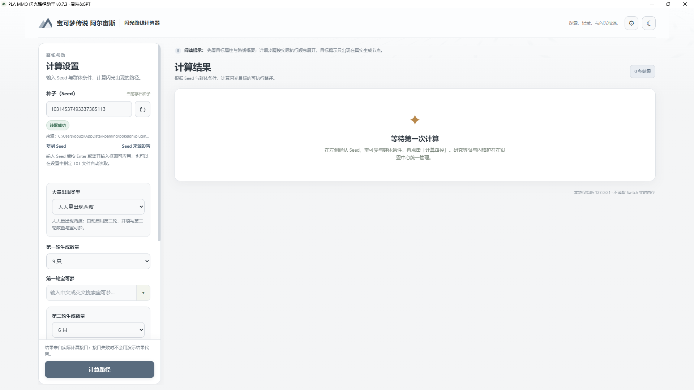
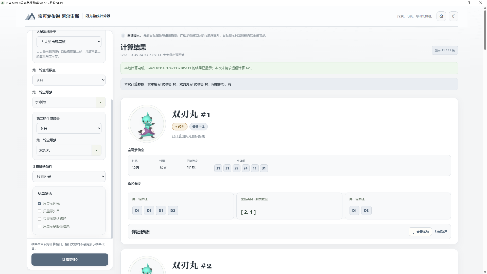
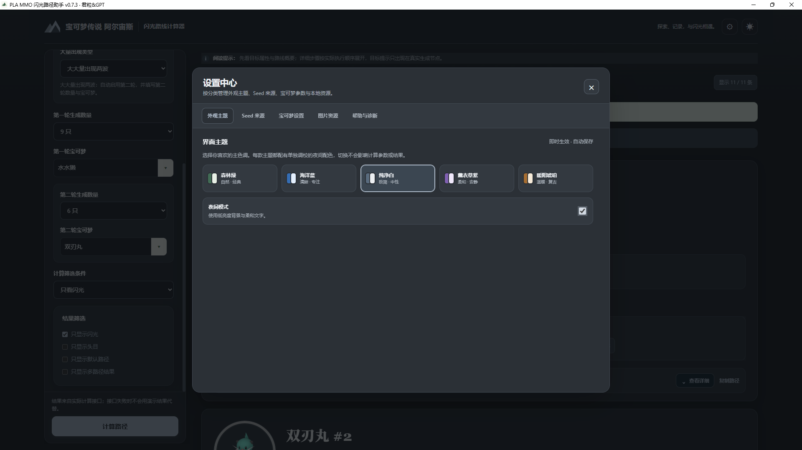
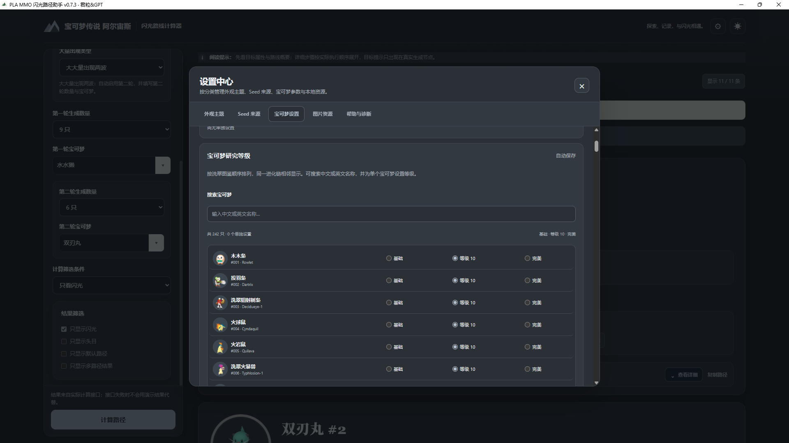
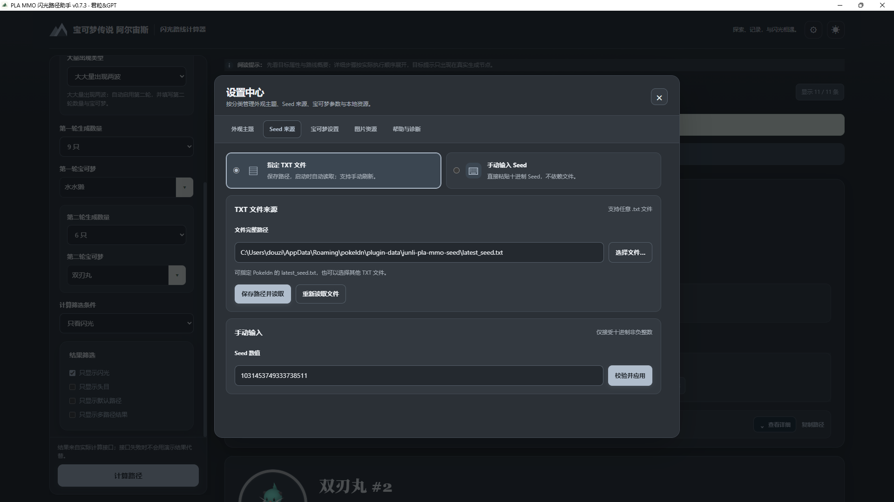

# PLA MMO Path Finder｜宝可梦传说 阿尔宙斯闪光路径计算器

**作者：君粒&GPT** · **当前版本：v0.7.3** · **平台：Windows 10/11**

PLA MMO Path Finder 是一个面向《宝可梦传说 阿尔宙斯》大量出现（Massive Mass Outbreak，MMO）的本地闪光路径计算工具。输入 Seed、选择群体类型与目标宝可梦后，程序会调用本地 RNG 计算引擎，整理可执行的路径和步骤说明。

> 本项目是非官方粉丝工具，与 Nintendo、The Pokémon Company、GAME FREAK 或 Creatures Inc. 没有隶属、赞助或官方认可关系。宝可梦名称、图像及相关商标归各自权利人所有。

## 截图预览

以下五张图是**截图占位图**，用于预留 GitHub 项目展示位置。发布者可以用真实软件截图替换同名文件；建议截图前隐藏个人路径、用户名及其他不希望公开的信息。

| 主界面 | 计算结果与执行路径 |
|---|---|
|  |  |
| **主题与夜间模式** | **宝可梦研究等级设置** |
|  |  |

**Seed 来源、图片资源与帮助页面**



## 功能一览

- **本地 RNG 计算：** 使用本地计算引擎计算路径，不向远程计算 API 发送 Seed 或路径参数。
- **Seed 来源：** 支持从 TXT 文件读取 Seed，也支持手动输入；支持刷新和 Seed 变化确认。
- **多种 MMO 场景：** 支持普通大量出现、大大量出现及两波大大量出现等路径参数。
- **宝可梦研究等级：** 可统一设置全图鉴研究等级，也可单独调整某只宝可梦；同一宝可梦在不同轮次使用相同的单独设置。
- **闪耀护符与筛选：** 在宝可梦设置中管理闪耀护符状态，并按支持的结果条件筛选。
- **结果说明：** 显示宝可梦信息、排序编号、路径概要和可展开的详细执行步骤。
- **多主题与夜间模式：** 提供森林绿、海洋蓝、纯净白、薰衣草紫、暖阳琥珀五种主题及对应夜间配色；主题偏好会保存在本地。
- **桌面窗口：** Windows 正常启动时使用独立桌面窗口，不必一直占用普通浏览器标签页。
- **可选图片资源：** 图片不是计算依赖；可以按需下载或自行提供图片。下载前会询问用户。
- **便携版与安装版构建：** 提供 Windows 构建脚本，能够生成便携版或安装版。

## 快速开始

### 方式 A：直接运行源码

**环境要求**

- Windows 10 或 Windows 11。
- Python 3.10 或更高版本；建议使用受支持的 64 位 Python。
- Microsoft Edge WebView2 Runtime，用于独立桌面窗口。多数较新的 Windows 10/11 系统已安装；若程序提示缺少，请按提示安装。
- 首次启动需要联网，以安装 Python 依赖并准备本地计算引擎。准备完成后，日常路径计算在本机执行。

**启动步骤**

1. 下载本仓库 ZIP，完整解压到一个普通文件夹；不要只复制 `start.bat`。
2. 双击项目根目录的 `start.bat`。
3. 首次启动时，按提示允许安装依赖并下载上游计算引擎文件。请等待初始化完成。
4. 程序打开后，点击右上角齿轮进入「设置中心」。
5. 在「Seed 来源」中选择 TXT 文件或手动输入 Seed。
6. 在主页设置 MMO 类型、生成数量和目标宝可梦，随后点击「计算路径」。

如需重新准备本地计算引擎，可运行根目录的 `prepare_offline_engine.bat`。首次初始化失败时，请先查看项目目录中的 `offline_engine_setup.log`。

### 方式 B：编译 Windows EXE

项目提供构建脚本，但**本源码仓库不包含已经编译好的 Windows EXE**。请在 Windows 电脑上操作：

1. 双击 `build_tools\\build.bat`。
2. 按菜单选择构建类型：
   - `1`：便携版（EXE 与资源目录打包为 ZIP）。
   - `2`：安装版（Setup 安装程序）。
   - `3`：同时生成便携版和安装版。
3. 按提示完成依赖安装和构建。
4. 构建输出位于 `build_tools\\output\\`；构建日志与报告位于 `build_tools\\reports\\`。

构建需要网络来获取缺失的构建依赖。安装版需要 Inno Setup；构建脚本会尝试检测或引导安装。自定义图标可放入 `build_tools\\logo.icon`；如果不存在或无效，则使用 `build_tools\\default_app.ico`。

### 方式 C：开发与测试

开发者可以使用 `start_dev.bat` 启动开发模式。安装依赖后，可运行 Python 测试：

```powershell
py -3 -m pip install -r requirements.txt
py -3 -m unittest discover -s tests -v
```

如果某些测试依赖 Node.js，安装 Node.js 后也可运行仓库中对应的 JavaScript 测试脚本。实际测试结果可能受操作系统、Python 版本和依赖版本影响。

## 新手使用手册

> 提醒：根目录的 `preview.html` 只是早期视觉预览，不包含真实计算逻辑。请运行 `start.bat` 使用正式程序。

### 1. 设置 Seed

- **TXT 文件模式：** 在「设置中心 → Seed 来源」选择包含 Seed 的 TXT 文件并保存。刷新按钮会重新读取已配置的文件。
- **手动输入模式：** 在同一分类切换到手动输入，粘贴十进制非负整数并应用。
- 页面状态会说明当前 Seed 的来源。若程序检测到 Seed 变化，会先提示确认。
- 程序只读取 Seed 文件，不会主动修改原 TXT 文件。

### 2. 设置路径条件

在主页选择群体类型、第一轮生成数量和目标宝可梦。若当前场景需要第二轮参数，再设置第二轮生成数量和目标宝可梦。可用选项会根据场景变化。

### 3. 设置研究等级和闪耀护符

进入「设置中心 → 宝可梦设置」：

- 可一键将全图鉴宝可梦统一设为基础等级、研究等级 10 或完美研究。
- 也可以搜索某只宝可梦并单独设置研究等级。
- 闪耀护符状态在同一分类的通用设置中管理。
- 设置会自动保存在本机，并用于后续计算。

计算完成后，结果区域会显示本次实际使用的研究等级与闪耀护符摘要。请以本次计算的摘要和结果步骤为准。

### 4. 阅读路径结果

每张结果卡片会展示宝可梦信息、路径概要和详细步骤。点击「查看详细」可以展开操作说明。路径代码（如 D1、D2）应结合对应步骤说明理解；请按结果中实际显示的顺序执行。

### 5. 宝可梦图片

图片资源是可选项，不影响 RNG 计算。程序在下载图片前会询问确认；如果跳过下载，仍可正常使用计算器。也可以在设置的「图片资源」中检查资源状态、补全图片或打开自定义图片目录。

## 隐私与本地数据

- 应用本地服务默认绑定 `127.0.0.1`，不面向局域网或公网开放。
- 路径计算由本地引擎处理；应用不会为了计算结果调用远程计算 API。
- 首次准备引擎、安装依赖或下载可选图片时会访问相应公开项目或包源。
- 设置、运行日志、下载的图片和自定义图片通常存放在当前 Windows 用户的应用数据目录中。Seed TXT 文件只读。
- 如果你准备公开截图，请先遮挡用户名、个人文件路径、私人 Seed 和其他敏感信息。

## 常见问题

### 启动时提示没有 Python

安装 Python 3.10 或更高版本，并确保安装器允许命令行使用 Python。随后重新运行 `start.bat`。

### 桌面窗口无法打开

检查 Microsoft Edge WebView2 Runtime 是否已安装。若端口被其他进程占用或启动失败，请先关闭本程序的旧实例，并查看 `startup.log`、`runtime_errors.log` 或设置中心的诊断报告。不要手动结束不认识的进程。

### 一直显示正在准备本地计算引擎

等待首次初始化完成。如果失败，查看 `offline_engine_setup.log`，确认网络可访问上游仓库，再运行 `prepare_offline_engine.bat` 重试。

### 没有宝可梦图片

图片不是计算依赖。进入「设置中心 → 图片资源」按需下载或补全；也可以使用自定义图片目录。个别形态可能没有可用的上游图片。

### 如何报告 Bug

提交 Issue 时请说明 Windows 版本、Python 版本、应用版本、复现步骤和错误日志。**不要上传真实存档、账户凭据或包含个人隐私的完整目录。** 如果日志包含个人路径或 Seed，请先遮挡后再发布。

## 项目结构

```text
PLA-MMO-Path-Finder-v0.7.3/
├─ app.py                       # Flask 本地服务与 API
├─ start.bat                    # 普通启动入口
├─ start_dev.bat                # 开发模式启动入口
├─ prepare_offline_engine.bat   # 准备／修复本地计算引擎
├─ pla_mmo/                     # Seed、设置、路径与本地引擎封装
├─ offline_engine/              # 上游 MMO RNG 引擎与数据资源
├─ templates/                   # 实际应用页面模板
├─ static/                      # CSS、JavaScript、图标和可选图片目录
├─ preview.html                 # 仅供视觉预览的静态页面，不具备计算功能
├─ build_tools/                 # EXE／安装包构建脚本与默认图标
├─ tests/                       # 回归测试
├─ docs/screenshots/            # GitHub README 截图位置
├─ README.md
├─ CHANGELOG.md
├─ LICENSE
└─ LICENSES.md
```

## 上游项目、依赖与图片来源

### 本地计算引擎

- **上游项目：** [capitalism-sudo/pla-multi-checker-web](https://github.com/capitalism-sudo/pla-multi-checker-web)
- **用途：** 提供 MMO RNG 路径计算相关代码与数据资源。本项目的准备脚本获取并整理所需模块，计算时使用本地文件。
- **许可证：** GPL-3.0。相关许可证文本随仓库提供，详见 [`LICENSES.md`](LICENSES.md) 与 `offline_engine/UPSTREAM_LICENSE_GPL-3.0.txt`。

### 宝可梦图片

- **图片来源：** [PokeAPI/sprites](https://github.com/PokeAPI/sprites) 与 [PokeAPI](https://pokeapi.co/)。
- **使用方式：** 图片为可选资源；本项目默认不将整套宝可梦图片打包进源码。用户明确确认下载后，程序才会下载可用图片并缓存到本机。
- **权利说明：** 宝可梦名称、角色形象、游戏素材和商标归 Nintendo、The Pokémon Company、GAME FREAK、Creatures Inc. 及相应权利人所有。公开仓库中可访问的图片不代表可以不受限制地再分发。本项目不声称拥有这些素材，也不代表或获得上述公司背书。

### 主要运行依赖

- [Python](https://www.python.org/)
- [Flask](https://github.com/pallets/flask) — 本地 Web 服务
- [pywebview](https://github.com/r0x0r/pywebview) — Windows 桌面窗口
- [z3-solver](https://github.com/Z3Prover/z3) — 求解器依赖
- [PyUSB](https://github.com/pyusb/pyusb) — 上游依赖链使用的 USB 库

精确依赖版本范围见 [`requirements.txt`](requirements.txt) 与 `build_tools/requirements-build.txt`。各依赖保留其各自的许可证与版权声明。

## 许可证

本仓库以 **GNU GPL v3.0** 发布。完整文本见 [`LICENSE`](LICENSE)。第三方组件和素材来源说明见 [`LICENSES.md`](LICENSES.md)。分发包含上游引擎的源码或可执行文件时，请一并保留适用的许可证和版权声明，并遵守 GPL-3.0 的相应要求。

## 致谢

感谢上游项目作者及开源依赖维护者。感谢提供反馈、测试 Seed 流程、桌面窗口、主题、图片资源与路径显示的玩家。

**作者：君粒&GPT**
